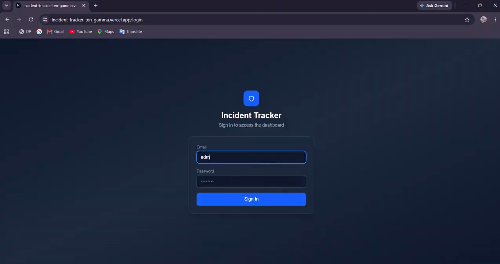
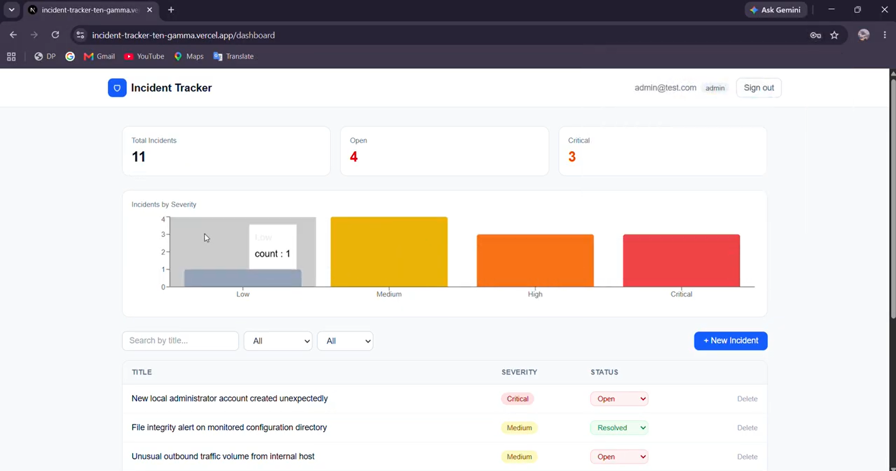

Incident Tracker
A web-based incident management application built with **Next.js, MongoDB, and NextAuth.js**. It helps teams record, monitor, and manage security incidents through a centralized dashboard.
The application provides incident tracking, role-based access, dashboard statistics, and visual analytics to make incident management easier.

Features
- Authentication: Login system using NextAuth.js credentials authentication.
- Role-Based Access: Admin-specific permissions for managing incidents.
- Incident Management: Create, view, update, and delete incidents.
- Severity Tracking: Categorize incidents by severity.
- Status Management: Track incidents based on their current status.
- Dashboard Analytics: View incident statistics and severity distribution.
- Search and Filtering: Find incidents using search, status, and severity filters.
- Database Integration: Store incident and user information using MongoDB.

Tech Stack
| Frontend | Next.js, React, TypeScript |
| Styling | Tailwind CSS |
| Backend | Next.js API Routes |
| Authentication | NextAuth.js |
| Database | MongoDB Atlas |
| ODM | Mongoose |
| Charts | Recharts |
| Deployment | Vercel |
| Version Control | Git, GitHub |

Getting Started
1. Clone the repository
git clone https://github.com/aamalrxj/incident-tracker.git

2. Navigate to the project directory
cd incident-tracker

3. Install dependencies
npm install

4. Configure environment variables
Create a `.env.local` file in the root directory:
MONGODB_URI=your_mongodb_connection_string
NEXTAUTH_SECRET=your_nextauth_secret
NEXTAUTH_URL=http://localhost:3000

Replace the placeholder values with your actual configuration.
- `MONGODB_URI`: MongoDB Atlas connection string.
- `NEXTAUTH_SECRET`: Secret used by NextAuth.js.
- `NEXTAUTH_URL`: Base URL of the application.

Important: Make sure your MongoDB database has the required user records. User passwords should be stored using the hashing format expected by the authentication system.

5. Run the development server
npm run dev

Application Workflow
1. Users access the application through the login page.
2. NextAuth.js validates their credentials.
3. Authenticated users are redirected to the incident dashboard.
4. Users can create and monitor incidents.
5. Admin users have additional permissions to update and delete incidents.
6. Dashboard statistics and charts provide an overview of reported incidents.

Deployment
The application is deployed using Vercel, with the source code maintained on GitHub and MongoDB Atlas used as the database.
For deployment, configure the required environment variables in Vercel before building the application.

Future Improvements
- Add detailed incident activity logs.
- Implement incident assignment and team management.
- Add email and real-time incident notifications.
- Introduce advanced filtering and reporting.
- Improve API validation and authorization.
- Add automated tests for authentication and incident management.

Demo Video : https://drive.google.com/file/d/114rzI3dXQS6wwPSwAdcqMb0iX_4ckjTo/view?usp=drive_link
